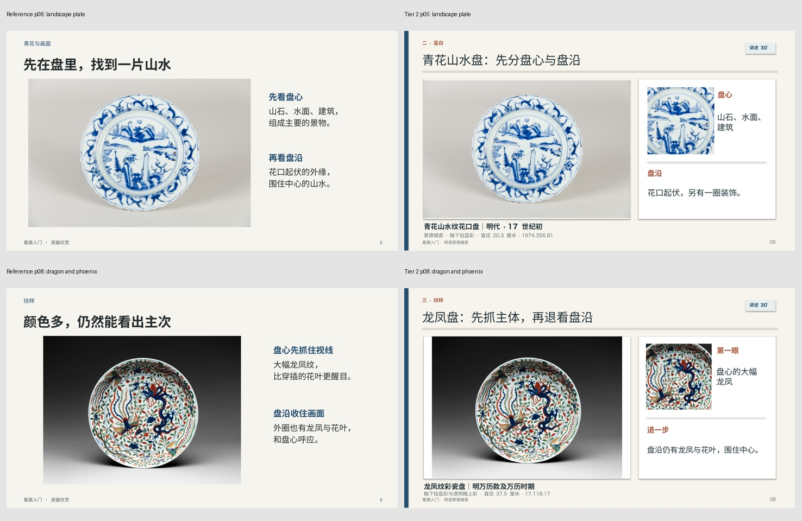
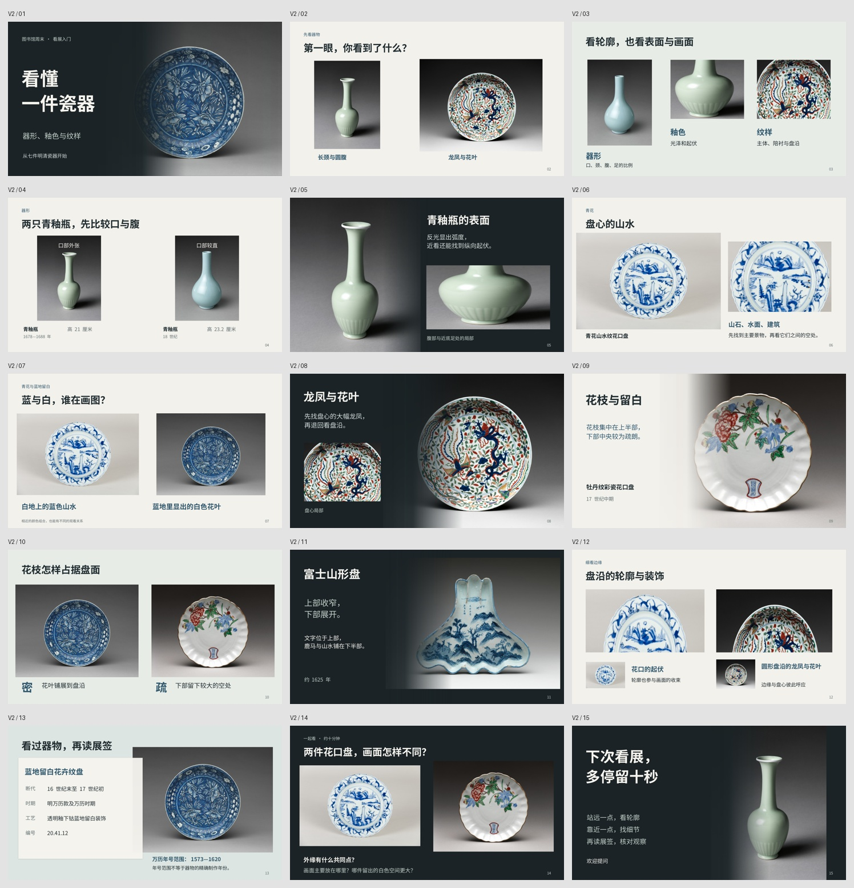
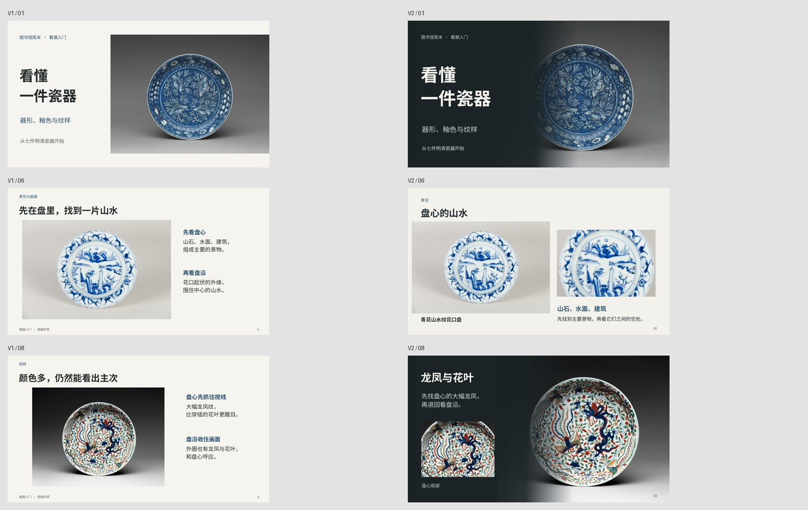

# PPT 审美经验与瓷器参考返工

- 日期：2026-10-13
- 专业领域：跨领域，视觉设计与 Office 排版
- 任务类型：三档美观度参考、现场讲解 PPT、个人审美经验沉淀
- 状态：第二版被用户否定；艺术展参考方向获认可，修订方法待新成品验证；未替换平台参考或提交
- 关键词：图文融合、局部放大、视觉节奏、第三档、平台检测、参考对照

## 背景与目标

用户已经多次参与旅行宣传、文化项目交流和香氛活动 PPT 的迭代。新任务选用七件明清瓷器的开放授权图片与基本藏品数据，制作图书馆成年读者讲座的讲师用 PPT。它应既能教会听众观察器物，也具备足够的视觉完成度。

用户指出第一版参考与第二档差距不大，甚至某些地方更弱，并要求把以前认可过的审美处理真正沉淀下来。随后要求重做 PPT，并把技能和复盘一起保存在 GitHub。

## 问题表现

第一版参考内容完整、文字原生可编辑、无明显乱码或越界，平台美观检查也通过了。但这只能证明可用。

参考第 6、8 页讲盘心与盘沿，主要依赖侧边短文；第二档对应第 5、8 页已经给出局部特写，听众更容易看到所讲位置。参考第 12 页的标题指向盘沿，画面却仍是两张整件照片。双图并排和左图右文连续重复，15 页同一种浅底，页面节奏不足。

## 影响

参考的“更高档”主要靠整洁、较少装饰和更舒展的文字来解释，没有用对应页证明足够的实质优势。若继续提交，就会把基础门槛误当审美水准，并增加用户检查和返修成本。

## 根因

旧记录偏向文件大小、字体、版本、上传和模型筛选，没有保存“什么画面被认可、为什么、下次如何迁移”的具体证据。即使读过演示文稿技能，也没有把用户的历史样本落实为验收条件。

另一个偏差是把“克制”理解成减少框、阴影与色彩，把“统一”理解成所有页面都使用同一底色和结构。第二档的模板负担被看见了，它的有效细节却没有被同等重视。

## 解决过程

### 回看三个实际样本

旅行 19 页、诗歌之城 12 页、香氛 16 页，加上瓷器参考与第二档各 15 页，共 77 页，重新用同一 LibreOfficeDev 26.8.0.0.alpha0 渲染，检查总览和相关关键页。原件未改动。

旅行第 7、14 页说明照片可以直接承担构图，局部明暗既保证文字可读，又保护瀑布、城楼和夕阳。第 18 页费用转为浅色信息区是有必要的变化，并不破坏整套语境。

诗歌之城第 6、7 页的颜色来自活动海报，第 9 页现场照片说明设计与城市的关系，第 10、11 页分别适合时间线和数字重点。这个样本说明纯色页不等于单调，关键在内容关系和视觉中心。

香氛第 10、11、12 页的小样、正装和礼盒与服务内容对应，流程、对照表和问答页仍延续摄影色调。用户所要的是整套完成度，而不是前几页像品牌画册，后面退回办公列表。

### 转成可执行的审美要求

先选主图和文字落点，避免把素材塞进预先固定的两个框。渐变、透明和阴影应服务对比与空间关系，不是给所有元素加效果。比较时看可见物体的大小，不只检查图片容器是否等大。

每页按实际任务组织：完整器物、局部细读、两件比较、展签、互动都应有所区别。页面可以共用视觉语言，但不能因为统一而失去节奏。信息页也要有合适的图像或刻意设计的纯色结构。

### 重做瓷器第二版

保留十五页、七件器物、输入材料、背景、Prompt 和模型原件。重做摄影与画布的过渡，增加青釉表面、山水盘心、龙凤与盘沿的真实局部，调整深浅节奏，并把展签做成与器物相连的信息结构。

先渲染封面、山水细读和展签三个关键样页，再完成整套。新文件单独编号，旧参考与平台数据不动。第二版仍是给用户看效果的修订稿，不宣称已经通过人工审美或平台质检。

## 已形成的方法与第二版试作

技能入口放在 [morandi-ppt-aesthetics](../03-经验/skills/morandi-ppt-aesthetics/SKILL.md)，实例、用户偏好与反例放在其 casebook。项目入口和经验索引接入该技能。

基础可用性与视觉质量分别验收。匹配内容的参考页与第二档同尺度并排，记录双方各自更好的地方。没有明显优势就继续改参考，不破坏模型结果来制造差距，也不靠漂亮的档位说明补救。

## 验证证据

- 五份历史对照文件共 77 页，来源字节未改动。
- 审美技能通过结构校验；这只证明技能格式有效，不证明生成效果已经达标。
- 第二版 15 页、9,621,908 字节。PPTX SHA256：`e596d7c4013d959543fe9c16d44ba7ac5f5d5e7565176f5e164430a82e5f0a1c`。同版 PDF 15 页，SHA256：`16ed663c39bf30028584c7a70c29bce2c046521736722fe4850e0068f1142c6f`。
- 使用真实器物照片、原生文字与独立渐变图层；字体为 Source Han Sans CN。结构、几何和原生重新导入校验通过。15 页实际渲染已检查，另修正第 3、4、8 页的标签与对比问题后重新渲染。
- 文件检查通过不是审美验收；第二版后来被用户否定，见下文最新校准。
- 输入、Prompt、两个已选模型档位和网页未修改；没有最终提交。
- 本仓库为公开仓库。不上传旧客户 PPT、输入材料或未明确允许公开分发的图片，只保存文字经验及本题 CC0 瓷器摄影形成的预览。

## 第二版反馈与新的校准

用户认为第二版略好，但仍模板感强、内容不足、整体偏素，并有边框重叠和空间分布问题。这表明先前原则还没有落实为足够好的画面；增加局部、渐变和深浅变化并未解决全部问题。

随后展示公开案例的实际正文。用户明确认可 [AbleSlide 艺术展《持续反（YING）》](https://www.digitaling.com/articles/203818.html)，特别是“隐形人”和“表现形式6”的方向。“隐形人”的照片用观看距离组织观察；“表现形式6”让雕塑、后层大字、背景与具体正文形成同一构图。不能将这种认可简化为黑底、大字、三个栏目或统一遮罩。

修订后的方法是先确定听众要看懂什么及需要的图像证据，再决定构图与实现工具，不先固定左右容器。正文需要有实际特征、关系与解释，不能只剩“先看……再看……”的泛化指令。

用户补充可以自行生成背景和组件。因此允许主动使用生图制作整页视觉草图、背景、纹理、光影、透明前景或展示衬景，与真实照片及可编辑信息合成；不把原生形状能力当作创意上限。真实器物与事实证据仍保留，是否需要原生编辑取决于当次交付要求，不能把整页图片当作可编辑内容。

具体观察与检验办法放在 [艺术展校准与生图分工](../03-经验/skills/morandi-ppt-aesthetics/references/art-exhibition-calibration.md)。公开仓库只记录原案例链接和分析，不分发案例截图。

本次只修订技能和复盘，没有生成新 PPT、修改输入、重跑模型或操作平台。参考方向已获认可，新制作方法仍待成品验证。

## 下次如何提前避免

开始做同类稿件时先读对应案例，写出看得见的目标，而不是只写“高级、克制、专业”。早期样页必须含较难的信息或比较页，不能只做一张容易漂亮的封面。

完整渲染后先看整套节奏，再看每页。字体修复、压缩或局部返修后重看实际文件，不用旧截图证明新文件。平台检测结果、用户审美确认和最终质检分别记录。

## 可复用检查清单

- [ ] 本页主角、阅读顺序与图文关系清楚。
- [ ] 所讲细节在画面上真的看得见，且能回到完整对象定位。
- [ ] 后半部分的信息页没有掉出整套视觉语言。
- [ ] 留白有目的，结构变化与讲述任务有关。
- [ ] 与第二档相比，能指出对应页的具体优势，也承认对方更好的处理。
- [ ] 事实、可编辑性、字体、页数、文件体积和实际渲染分别检查。
- [ ] 新版 PPT、预览和档位说明属于同一版本。

## 关联资料

- [技能实例手册](../03-经验/skills/morandi-ppt-aesthetics/references/casebook.md)
- [The Met Open Access](https://www.metmuseum.org/hubs/open-access)：本题瓷器图片与基本藏品数据的开放政策，不代表全网站文章都可任意转载。
- [PPT-Design-Skill](https://github.com/sunchaokun/PPT-Design-Skill/blob/main/skill/SKILL.md)：设计判断参考，未安装它的构建链。

预览中的器物摄影来自 The Metropolitan Museum of Art Open Access，七件对象的公共领域标记已逐件核验：[青釉瓶](https://www.metmuseum.org/art/collection/search/42246)、[青釉瓶](https://www.metmuseum.org/art/collection/search/42414)、[山水花口盘](https://www.metmuseum.org/art/collection/search/50689)、[蓝地留白花卉盘](https://www.metmuseum.org/art/collection/search/42535)、[龙凤盘](https://www.metmuseum.org/art/collection/search/42543)、[牡丹花口盘](https://www.metmuseum.org/art/collection/search/76766)、[富士山形盘](https://www.metmuseum.org/art/collection/search/75822)。预览用于记录排版与讲解组织，原图只作等比缩放与局部裁切，没有改绘器物。
